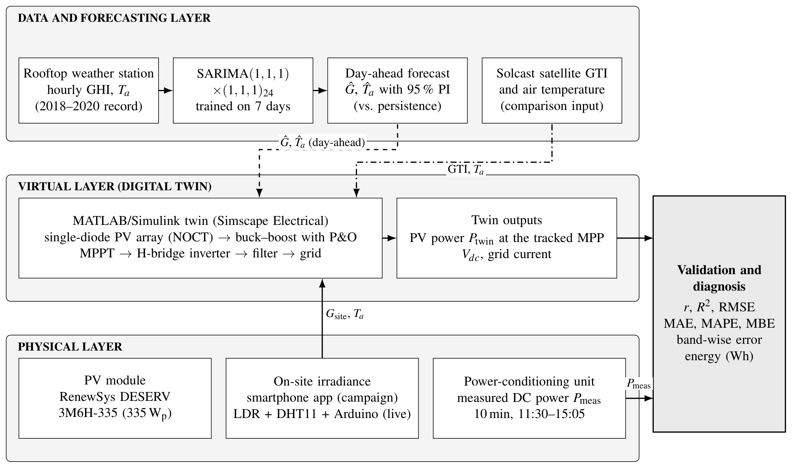
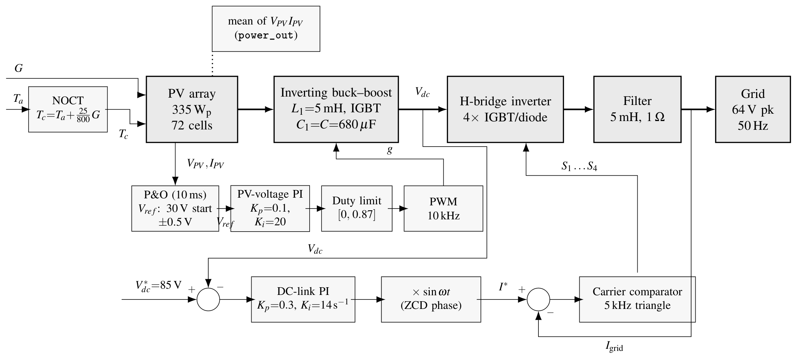
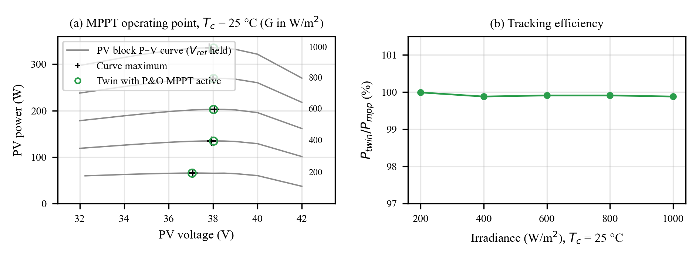
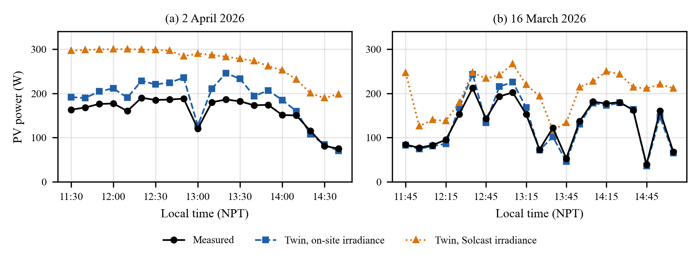
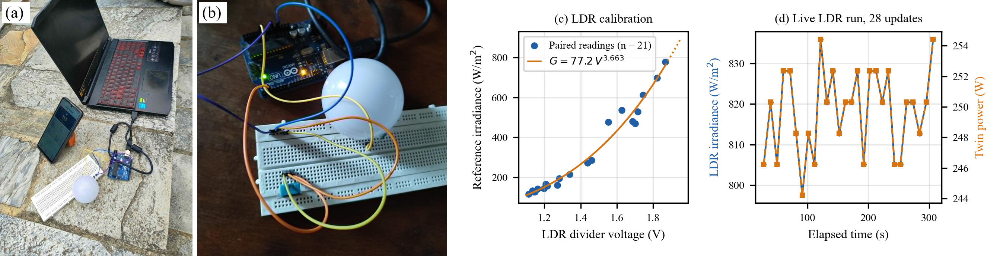
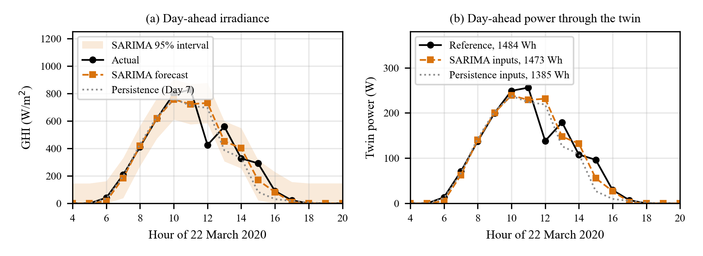
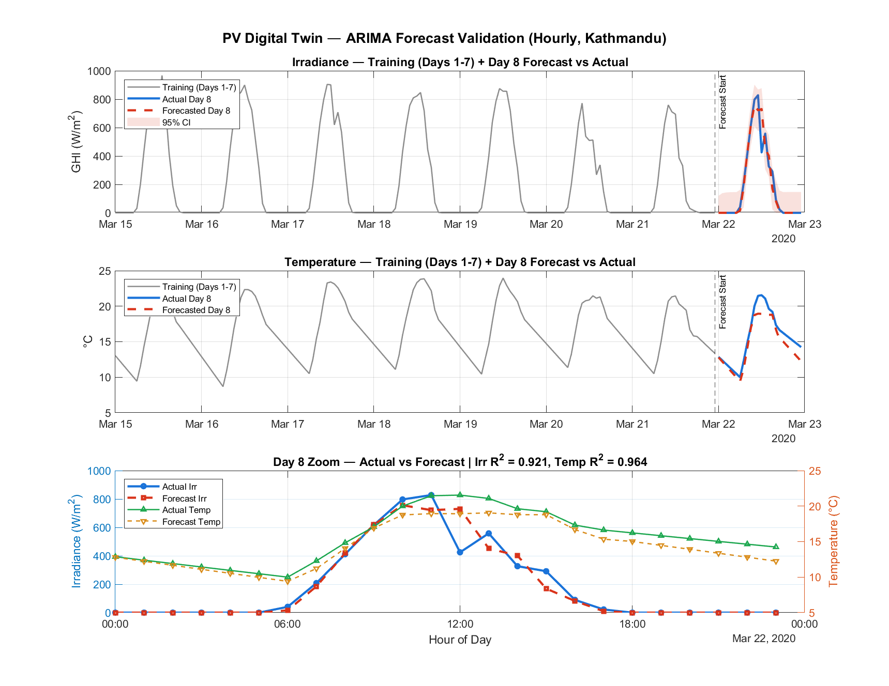

# PV Digital Twin for Real-Time Monitoring and Short-Term Forecasting

MATLAB/Simulink digital twin of a 335 W grid-connected photovoltaic (PV) module, validated against
field measurements, driven by a low-cost Arduino/LDR irradiance sensor, and coupled to a SARIMA
day-ahead weather forecaster.

Final-year project, B.E. Electrical Engineering, Department of Electrical Engineering, IOE Pulchowk
Campus, Tribhuvan University (Sep 2025 - May 2026).



## What is in the twin

| Stage | Implementation |
| --- | --- |
| PV module | RenewSys DESERV 3M6H-335 (72 cells, 335 W STC), single-diode model, datasheet temperature coefficients (Voc -0.30 %/degC, Isc +0.05 %/degC) |
| Cell temperature | NOCT model, Tc = Ta + (45 - 20)/800 x G (NOCT = 45 degC assumed) |
| DC-DC stage | Inverting buck-boost (5 mH, 680 uF), 10 kHz PWM, duty limited to [0, 0.87] |
| MPPT | Perturb and observe (10 ms, 0.5 V step) acting on the PV voltage reference through a PV-voltage PI controller |
| DC link | 85 V reference, PI regulator (Kp = 0.3, Ki = 14 /s) |
| Inverter | Single-phase H-bridge, 5 kHz carrier, current control, 5 mH / 1 ohm output filter |
| Grid | Scaled single-phase source, 64 V peak, 50 Hz |



At STC (1000 W/m2, 25 degC cell) the twin delivers **335.0 W** at 38.0 V (module rating 335 W,
V_mp 37.9 V). Across all 218 runs the DC link stays at 85.0-85.2 V.

## Results

### MPPT tracking

The tracker was tested against the PV block's own P-V curve (MPPT disabled, voltage reference held at
12 values from 32 to 42 V at each irradiance). With P&O active the twin reaches
**99.9-100 %** of the curve maximum at 200, 400, 600, 800 and 1000 W/m2.



### Field validation (41 readings, two days)

Power was recorded every 10 minutes between 11:30 and 15:05 on 2 April 2026 (clear) and
16 March 2026 (partly cloudy). The twin was driven by on-site irradiance (smartphone-app readings)
and, for comparison, by Solcast satellite-derived irradiance.

| Irradiance input | RMSE | MAE | MAPE | Mean bias | Pearson r |
| --- | ---: | ---: | ---: | ---: | ---: |
| On-site | 24.2 W | 18.5 W | 11.5 % | +13.6 W | 0.969 |
| Solcast | 99.8 W | 92.0 W | 80.3 % | +91.7 W | 0.693 |

Site-specific irradiance reduces the RMSE by a factor of four. On the clear day the twin
overestimates measured power (mean measured/twin ratio 0.876), which is consistent with losses the
model does not represent (for example wiring, soiling and module mismatch); on the partly cloudy day the ratio is about 1.0.



### Irradiance sensor

An Arduino Uno reads an LDR in a voltage divider; voltage is mapped to irradiance with a power law
G = a V^b. Calibration on 21 paired readings (116-779 W/m2) against a smartphone-based irradiance
reference gives **G = 77.2 V^3.663, R2 = 0.974**. The reference is not a certified pyranometer, so
the accuracy is limited by the reference.



### Day-ahead forecasting

SARIMA(1,1,1)x(1,1,1)24 models for irradiance and temperature were trained on seven days of hourly
data (15-21 March 2020, Kathmandu) and used to forecast the eighth day (22 March 2020). Persistence
(the previous day) is the baseline.

| Variable | Model | RMSE | MAE | Pearson r |
| --- | --- | ---: | ---: | ---: |
| Irradiance | SARIMA | 76.3 W/m2 | 34.7 W/m2 | 0.960 |
| Irradiance | Persistence | 82.9 W/m2 | 38.7 W/m2 | 0.953 |
| Temperature | SARIMA | 1.30 degC | 1.06 degC | 0.982 |
| Temperature | Persistence | 0.71 degC | 0.63 degC | 0.981 |

Both forecasts were passed through the twin. Daily energy on the validation day:

| Inputs | Energy | Error vs reference |
| --- | ---: | ---: |
| Measured weather (reference) | 1484 Wh | - |
| SARIMA forecast | 1473 Wh | -0.75 % |
| Persistence | 1385 Wh | -6.69 % |

Hourly power RMSE is 23.2 W for SARIMA and 25.6 W for persistence. The small daily-energy error
partly reflects compensation between over- and under-forecast hours (the midday dip at 12:00 is
missed), and only one validation day was used.




### Live sensor-to-twin run

`matlab/realtime/real_time_script.m` reads irradiance and temperature from the Arduino over a 9600
baud serial link, sets them as inputs of the twin, runs the model and logs the result.
`data/realtime_log.csv` holds the 28 samples of a 278 s run (LDR irradiance 798-836 W/m2). The
loop updated about every 10 s. The temperature channel (DHT11) read a constant 25.0 degC. Driving the
final twin with the logged irradiances gives 244-254 W (`data/simulation/`); the `Power_W` column in
the log is the model output at the time of the run.

## Repository layout

```text
simulink/PV_twin_final.slx        digital twin (MATLAB/Simulink R2024b, Simscape Electrical)
simulink/pv_block_parameters.txt  PV array block parameters
matlab/validation/                batch runner (run_jobs.m) and P-V sweep (pv_curve_sweep.m)
matlab/forecasting/               SARIMA forecasting and validation
matlab/calibration/               LDR calibration fit
matlab/realtime/                  live Arduino-to-Simulink script
arduino/arduinofile.ino           sensor node (LDR + DHT11)
python/make_jobs.py               builds the batch job lists
python/validation_metrics.py      recomputes the headline numbers from the saved runs
data/                             field readings, weather window, forecasts, live log
data/simulation/                  218 twin runs and the P-V sweep (outputs of the twin)
figures/                          figures used above
```

## Reproducing the numbers

```bash
python python/validation_metrics.py
```

recomputes STC power, MPPT tracking efficiency, the field validation table and the Day-8 energies
from the saved simulation runs. To rerun the simulations: `python python/make_jobs.py`, then call
`run_jobs(k, modeldir, jobfile, outfile, 1.5)` in MATLAB for each job file (and `pv_curve_sweep` for
the sweep).

## Limitations

* Measured power comes from two days of 10-minute readings (41 points) at one installation.
* On-site irradiance was measured with a smartphone application, and the LDR sensor was calibrated
  against it, not against a certified pyranometer.
* NOCT (45 degC) is an assumed value, and losses such as soiling and wiring are not modelled.
* The forecasting evaluation uses one held-out day, and night-time temperatures in the weather
  record are interpolated.
* The live run is open loop: there is no automatic recalibration or state correction.

## Team and supervision

Pratik Adhikari, Nirajan Chaudhary, Prashant Bisokarma, Shasank Adhikari.
Supervisors: Dr. Basanta Kumar Gautam (Pulchowk Campus) and Er. Deependra Neupane (Electricity
Regulatory Commission, Nepal).
